# 🚦 Luz Verde

> **Asesor de empleo con IA para Android.** Guarda tus candidaturas, pega una oferta y te dice con un semáforo si encaja contigo, y genera un CV para ATS adaptado a esa oferta sin inventar nada.

[](https://github.com/albertocll/LuzVerde/actions/workflows/ci.yml)
[](https://github.com/albertocll/LuzVerde/actions/workflows/codeql.yml)
[](https://openjdk.org/projects/jdk/21/)
[](https://spring.io/projects/spring-boot)
[](https://www.postgresql.org/)
[](https://expo.dev/)
[](https://www.typescriptlang.org/)
[](https://docs.anthropic.com/)

**Web:** [luzverde-empleo.netlify.app](https://luzverde-empleo.netlify.app/) · [Privacidad](https://luzverde-empleo.netlify.app/privacidad.html) · [Términos](https://luzverde-empleo.netlify.app/terminos.html) · [Borrar la cuenta](https://luzverde-empleo.netlify.app/borrar-cuenta.html)

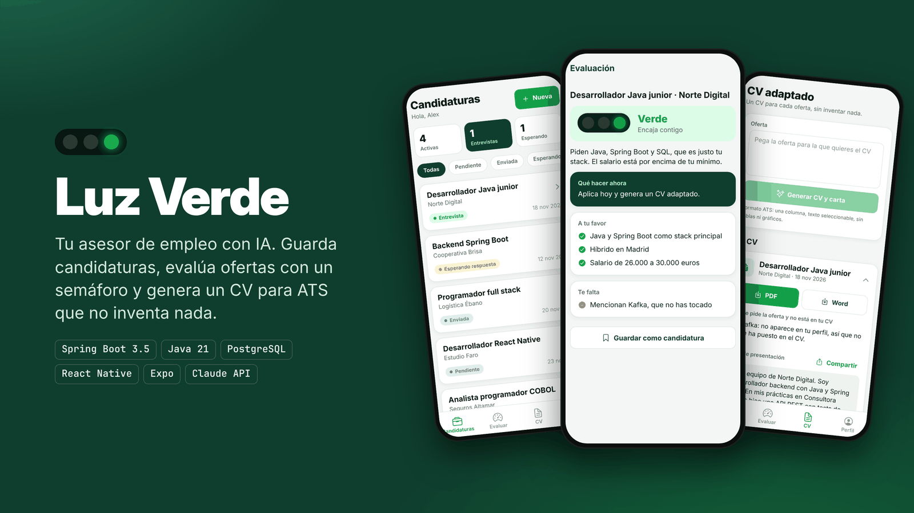

---

## 📖 Sobre el proyecto

**Luz Verde** nace de un problema concreto: cuando buscas trabajo acabas con decenas de ofertas, no sabes cuáles merecen la pena y adaptas el CV a mano para cada una. La app lo junta todo en un sitio.

- Pegas el texto de una oferta y la IA lo compara con tu perfil: **verde** si encaja, **amarillo** si encaja a medias, **rojo** si no. Te dice qué tienes a favor, qué te falta, qué banderas rojas ve y qué harías tú en su lugar.
- Con un toque genera un **CV en PDF y Word pensado para los filtros ATS** y una carta de presentación de 150 palabras como máximo.
- La regla dura es que **el CV no inventa nada**. Si la oferta pide algo que no está en tu perfil, no aparece en el CV y te lo dice como hueco.

Proyecto de portfolio de Alberto ([github.com/albertocll](https://github.com/albertocll)). Backend propio en Spring Boot con PostgreSQL y app en React Native con Expo.

---

## 📱 Pantallas

<p align="center">
  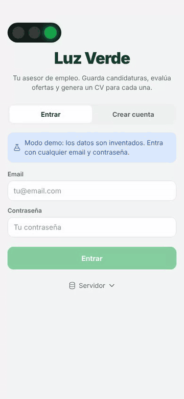
</p>

<p align="center"><em>Login, candidaturas, evaluación de una oferta, CV adaptado y perfil, en 19 segundos.</em></p>

| Candidaturas | Evaluar oferta | Resultado | CV adaptado | Perfil |
|:---:|:---:|:---:|:---:|:---:|
| 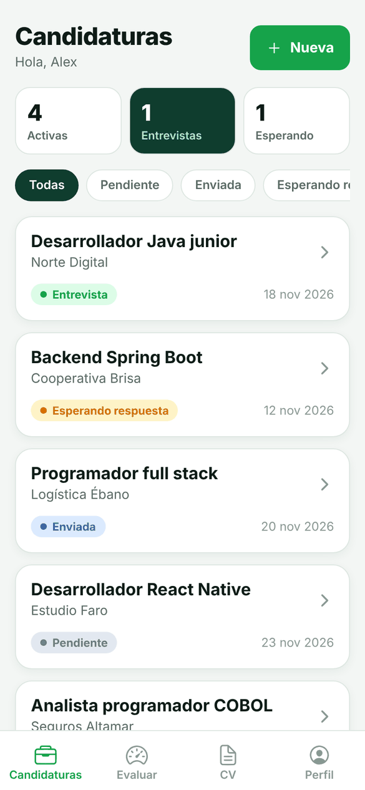 | 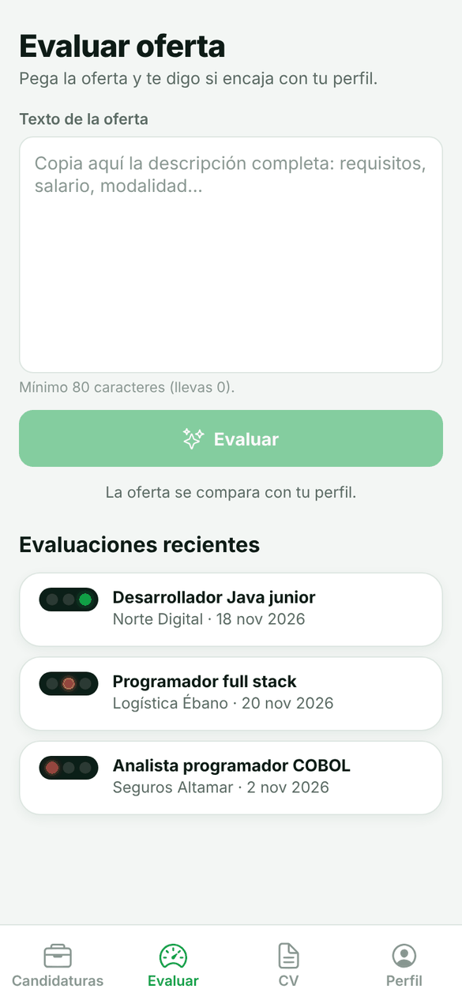 | 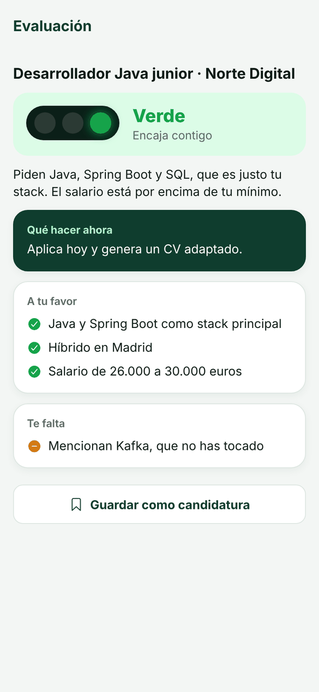 | 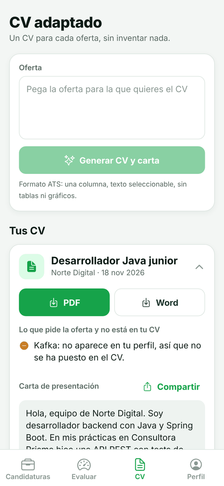 | 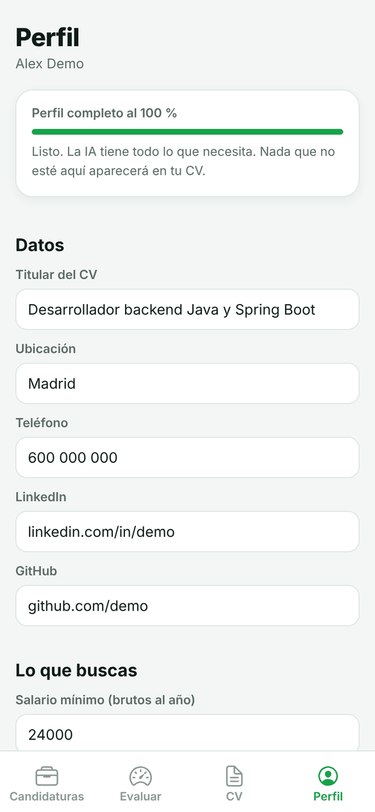 |

Las capturas salen del **modo demo**, con datos inventados. Para verlo en tu navegador sin backend:

```bash
cd mobile
npm install
npm run web:demo
```

Entra con cualquier email y contraseña. El modo demo no entra en la build de producción: solo se activa con `EXPO_PUBLIC_DEMO=1` y Metro elimina ese código de la build normal.

---

## ✨ Características

- 📋 **Candidaturas** con cinco estados (pendiente, enviada, esperando respuesta, entrevista, descartada), filtros y resumen de un vistazo
- 🚦 **Evaluador de ofertas con IA**: semáforo, pros, huecos, banderas rojas y acción recomendada
- 📄 **CV para ATS** en PDF (texto seleccionable) y DOCX, una columna, sin tablas ni gráficos
- ✉️ **Carta de presentación** de 150 palabras como máximo, lista para compartir
- 🛡️ **GuardianVeracidad**: comprueba en el servidor que el CV y la carta no mencionan nada que no esté en tu perfil
- 👤 **Perfil profesional** con stack por niveles, experiencia, proyectos, formación, idiomas, salario mínimo y modalidad
- 📊 **Barra de progreso del perfil** que te dice qué rellenar para que la IA tenga lo que necesita
- 🔐 **Autenticación JWT**, token en el almacén seguro de Android y límite de intentos de login
- 💸 **Gasto de IA controlado**: 10 usos por usuario y día y tope de tokens por llamada
- ♿ **Accesible**: roles, estados y etiquetas en botones, chips, campos y semáforo

---

## 🛠 Stack tecnológico

### Backend
- **Lenguaje:** Java 21
- **Framework:** Spring Boot 3.5 (Web, Data JPA, Security, Validation, Actuator)
- **Base de datos:** PostgreSQL 17 con migraciones de Flyway
- **Autenticación:** JWT (jjwt) con BCrypt
- **IA:** API de Claude (`claude-haiku-5-5`) con salida forzada por herramienta y esquema JSON fijo
- **Documentos:** OpenPDF para el PDF y Apache POI para el DOCX
- **Documentación de la API:** OpenAPI con Swagger UI (springdoc)
- **Tests:** JUnit 5, MockMvc y PostgreSQL 17 real con Testcontainers, cobertura con JaCoCo

### App móvil
- **Framework:** React Native 0.88 con Expo SDK 58
- **Navegación:** Expo Router (pestañas y pilas)
- **Lenguaje:** TypeScript 6
- **Almacenamiento seguro:** `expo-secure-store` (Keystore de Android)
- **Web:** `react-native-web` para la vista previa y el modo demo
- **Tests:** Jest y Testing Library

### Calidad y seguridad
- **CI:** GitHub Actions en cada push (tests del backend con cobertura mínima del 70 %, typecheck y tests de la app)
- **Análisis:** CodeQL con consultas `security-extended`
- **Secretos:** gitleaks en cada push
- **Dependencias:** Dependabot semanal y OWASP Dependency-Check cada lunes y en cada cambio del `pom.xml`

---

## 🏗 Arquitectura

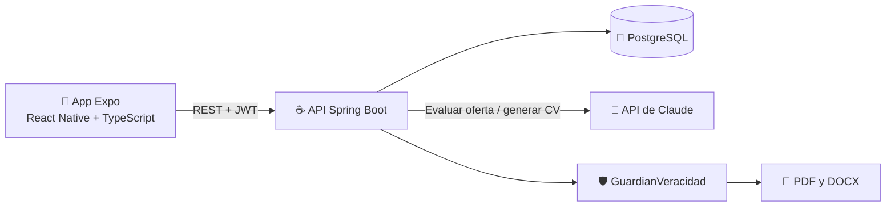

La clave de la API de Claude vive solo en el servidor. La app nunca la ve. Más detalle en [arquitectura](docs/arquitectura.md).

---

## 📁 Estructura del repositorio

```
LuzVerde/
├── backend/                 API REST en Spring Boot
│   └── src/main/java/es/albertocll/luzverde/
│       ├── auth/            Registro, login y límite de intentos
│       ├── candidatura/     CRUD de candidaturas
│       ├── perfil/          Perfil profesional
│       ├── evaluacion/      Evaluador de ofertas
│       ├── cv/              Generador de CV, GuardianVeracidad y renderizadores
│       ├── ia/              Cliente de Claude y límite de usos
│       ├── seguridad/       JWT
│       └── error/           Manejador de errores
├── mobile/                  App React Native (Expo)
│   ├── src/app/             Pantallas (Expo Router)
│   ├── src/componentes/     Semáforo, avisos y componentes de interfaz
│   └── src/demo/            API falsa del modo demo (solo web:demo)
├── docs/                    Arquitectura, decisiones, seguridad, interfaz y privacidad
│   └── img/                 Mockup, GIF de la demo y capturas del README
├── web/                     Página de presentación (luzverde-empleo.netlify.app)
├── .github/                 CI, CodeQL, Dependabot y plantillas
├── docker-compose.yml       PostgreSQL y backend para desarrollo local
└── .env.example             Variables de entorno de ejemplo
```

---

## ⚙ Puesta en marcha

### Requisitos
- Docker
- Node.js 22 para la app
- Java 21 y Maven solo si vas a ejecutar el backend fuera de Docker
- Android Studio con un emulador para probar la app en Android

### Backend

1. Clona el repositorio:
   ```bash
   git clone https://github.com/albertocll/LuzVerde.git
   cd LuzVerde
   ```

2. Copia `.env.example` como `.env` y rellena `DB_PASSWORD` y `JWT_SECRET`. Para la clave JWT vale `openssl rand -base64 48`. Si quieres usar la IA, añade `ANTHROPIC_API_KEY`.

3. Levanta la base de datos y el backend:
   ```bash
   docker compose up --build
   ```

   O solo la base de datos, y el backend desde el IDE:
   ```bash
   docker compose up db
   cd backend
   mvn spring-boot:run
   ```

   En este segundo caso el backend necesita `DB_PASSWORD` y `JWT_SECRET` en el entorno.

4. La API queda en `http://localhost:8080` y la documentación en `http://localhost:8080/swagger-ui.html`.

Sin `ANTHROPIC_API_KEY` todo funciona salvo el evaluador y el CV, que responden 503.

### App en el emulador de Android

1. Con el backend arrancado, abre un emulador desde el Device Manager de Android Studio.
2. En otra terminal:
   ```bash
   cd mobile
   npm install
   npx expo start --android
   ```

En el emulador, `http://10.0.2.2:8080` apunta al backend de tu ordenador. La URL se cambia desde la app (Perfil o el desplegable Servidor del login) o con `EXPO_PUBLIC_API_URL`.

### Scripts de la app

| Script | Qué hace |
|---|---|
| `npm run android` | Arranca Expo y abre la app en Android |
| `npm run web` | Arranca la app en el navegador contra el backend |
| `npm run web:demo` | Arranca la app en el navegador con datos inventados |
| `npm run export:demo` | Genera la web del modo demo en `dist-demo/` |
| `npm run typecheck` | Comprueba los tipos |
| `npm test` | Ejecuta los tests |

### Builds con EAS

`mobile/eas.json` tiene tres perfiles:

| Perfil | Sale | Entorno | Backend |
|---|---|---|---|
| `desarrollo` | APK | `desarrollo` | Se cambia desde la app |
| `preview` | APK | `produccion` | Fijo, `EXPO_PUBLIC_API_URL` |
| `production` | AAB para Google Play | `produccion` | Fijo, `EXPO_PUBLIC_API_URL` |

En producción la app no enseña el campo Servidor y usa siempre la URL de la build. `EXPO_PUBLIC_API_URL` se crea en expo.dev (Environment variables) y tiene que ser `https`: si no, `scripts/comprobar-entorno.js` para la build antes de empezar.

```bash
cd mobile
npx eas-cli build --platform android --profile production
```

---

## 🧪 Tests

```bash
cd backend
mvn verify          # tests, y cobertura mínima del 70 % con JaCoCo

cd ../mobile
npm run typecheck
npm test
```

Los tests del backend arrancan un PostgreSQL 17 en Docker con Testcontainers, el mismo motor que en producción, y simulan la API de Claude. Necesitan Docker abierto, pero no créditos. El informe de cobertura queda en `backend/target/site/jacoco/index.html`.

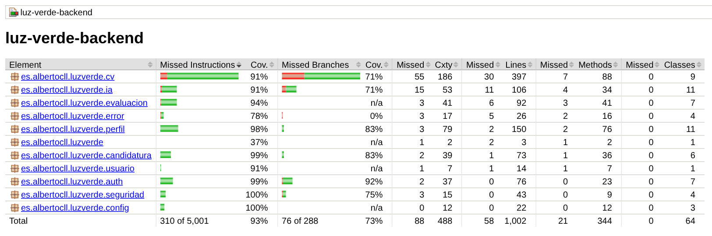

Pruebas de extremo a extremo con Maestro en `mobile/.maestro` (login, candidaturas y evaluación). Se lanzan en un emulador con `maestro test .maestro`; ver su [LEEME](mobile/.maestro/LEEME.md).

---

## 🚦 Evaluador de ofertas

`POST /evaluaciones` recibe el texto de una oferta, lo compara con tu perfil usando la API de Claude y devuelve un semáforo (`VERDE`, `AMARILLO` o `ROJO`) con pros, huecos, banderas rojas y la acción recomendada.

- El modelo responde llamando a una herramienta con un esquema JSON fijo. La salida siempre tiene la misma forma.
- El texto de la oferta va entre etiquetas y el prompt dice que es un dato, no instrucciones.
- Límite de 10 usos de IA por usuario y día (hora de Madrid) y tope de tokens por llamada.
- Modelo por defecto `claude-haiku-5-5`. Se cambia con `ANTHROPIC_MODELO`.

---

## 📄 Generador de CV

`POST /cv` genera un CV adaptado a la oferta en PDF y DOCX, más una carta de presentación.

Formato pensado para ATS: una sola columna, sin tablas, imágenes, iconos ni barras de nivel, Helvetica en el PDF y Arial en el DOCX, apartados con nombres normales (Perfil, Tecnologías, Experiencia, Proyectos, Formación, Idiomas) y fechas en formato `MM/AAAA`.

Cómo se asegura que no inventa nada, sin fiarse solo del modelo:

- Puestos, empresas, fechas, títulos y centros salen siempre del perfil. El modelo solo elige el orden y reformula las viñetas.
- Las tecnologías del CV son las del perfil con nivel sólido o medio. Si el modelo propone otra, se descarta.
- Cualquier frase que nombre una tecnología que pide la oferta y que no tienes se elimina del CV y de la carta, y esa tecnología pasa a la lista de huecos.
- Las experiencias y proyectos que el modelo no use se añaden igualmente con tu texto.

Así queda el PDF, generado por `RenderizadorPdf` con un perfil de ejemplo:

<p align="center">
  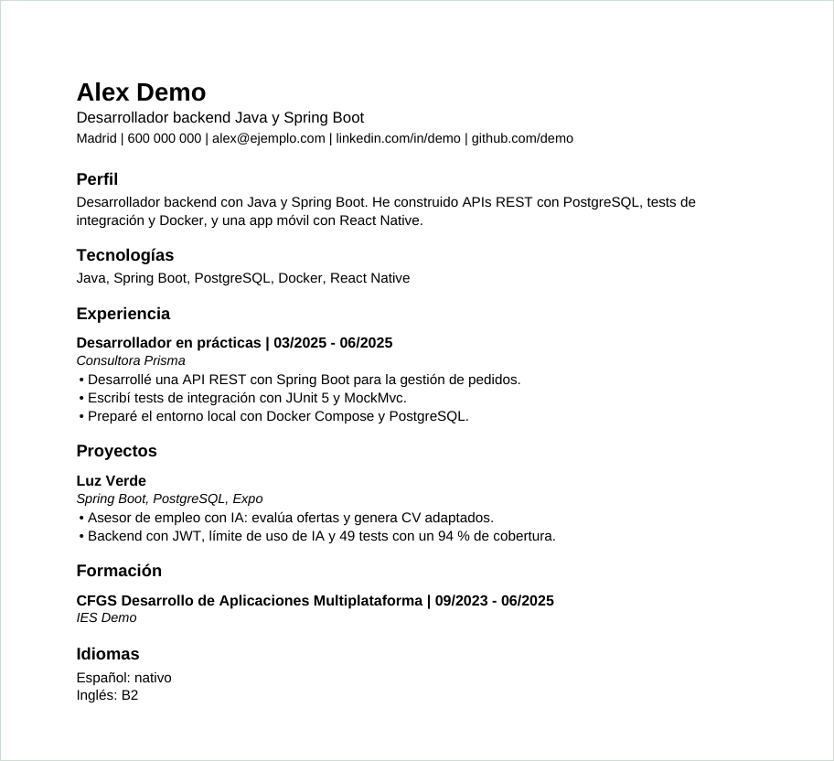
</p>

---

## 🔌 API

<details>
<summary>Ver la documentación de Swagger UI</summary>

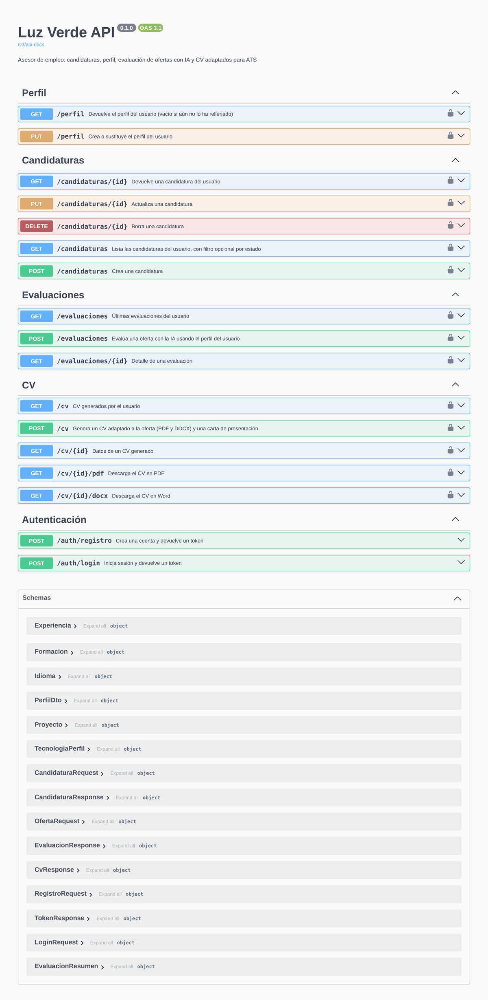

</details>

Todas las rutas salvo `/auth/**`, Swagger y `/actuator/health` piden la cabecera `Authorization: Bearer <token>`. Cada usuario solo ve sus datos: lo ajeno responde 404, igual que si no existiera.

| Método | Ruta | Qué hace |
|---|---|---|
| POST | `/auth/registro` | Crea una cuenta si el email está libre. Responde igual si ya existe y no devuelve token |
| POST | `/auth/login` | Devuelve un token |
| GET | `/candidaturas?estado=ENVIADA` | Lista tus candidaturas, con filtro opcional por estado |
| GET | `/candidaturas/{id}` | Detalle de una candidatura |
| POST | `/candidaturas` | Crea una candidatura |
| PUT | `/candidaturas/{id}` | Actualiza una candidatura |
| DELETE | `/candidaturas/{id}` | Borra una candidatura |
| GET | `/perfil` | Tu perfil (vacío si no lo has rellenado) |
| POST | `/evaluaciones` | Evalúa una oferta con IA y devuelve semáforo, pros, huecos, banderas rojas y acción recomendada |
| GET | `/evaluaciones` | Tus últimas evaluaciones |
| GET | `/evaluaciones/{id}` | Detalle de una evaluación |
| POST | `/cv` | Genera un CV adaptado a una oferta (PDF y DOCX) y una carta de presentación |
| GET | `/cv` | Tus CV generados |
| GET | `/cv/{id}/pdf` | Descarga el CV en PDF |
| GET | `/cv/{id}/docx` | Descarga el CV en Word |
| PUT | `/perfil` | Crea o sustituye tu perfil |

---

## 🔐 Seguridad

- Contraseñas con BCrypt y tokens JWT firmados con HS256. Se rechazan tokens manipulados y `alg: none`.
- Login bloqueado 15 minutos tras 5 fallos con el mismo email o 20 desde la misma IP.
- Errores sin trazas ni mensajes internos, cabeceras de seguridad y Actuator limitado a `health`.
- Ningún secreto en el repositorio: todo va por variables de entorno, y gitleaks lo comprueba en cada push.

Cada riesgo, su medida y el test que lo cubre están en [seguridad](docs/seguridad.md). Para informar de un fallo, mira [SECURITY.md](SECURITY.md).

---

## 🔧 Variables de entorno

| Variable | Obligatoria | Uso |
|---|---|---|
| `DB_URL` | No | URL JDBC. Por defecto `jdbc:postgresql://localhost:5432/luzverde` |
| `DB_USER` | No | Usuario de PostgreSQL. Por defecto `luzverde` |
| `DB_PASSWORD` | Sí | Contraseña de PostgreSQL |
| `JWT_SECRET` | Sí | Clave en Base64 de al menos 32 bytes para firmar los tokens |
| `JWT_EXPIRACION_MINUTOS` | No | Duración del token. Por defecto 1440 (un día) |
| `PORT` | No | Puerto HTTP. Por defecto 8080 |
| `FORWARD_HEADERS_STRATEGY` | No | `native` detrás del proxy de Railway. Por defecto `none` |
| `ANTHROPIC_API_KEY` | Para usar la IA | Clave de la API de Claude |
| `ANTHROPIC_MODELO` | No | Modelo. Por defecto `claude-haiku-5-5` |
| `ANTHROPIC_MAX_TOKENS` | No | Tope de tokens de salida por llamada. Por defecto 2048 |
| `LIMITE_IA_DIARIO` | No | Usos de IA por usuario y día. Por defecto 10 |

En la app (se fijan al construir):

| Variable | Uso |
|---|---|
| `EXPO_PUBLIC_ENTORNO` | `desarrollo` (por defecto) o `produccion`. La ponen los perfiles de `eas.json` |
| `EXPO_PUBLIC_API_URL` | URL del backend. Obligatoria y `https` en producción |

---

## 🗺 Hoja de ruta

- [x] **Fase 1.** Backend base: registro y login, candidaturas, perfil, tests y Swagger
- [x] **Fase 2.** Evaluador de ofertas con la API de Claude
- [x] **Fase 3.** Generador de CV compatible con ATS
- [x] **Fase 4.** App React Native
- [ ] **Fase 5.** Despliegue en Railway
- [ ] **Fase 6.** Publicación en Google Play

El detalle está en la [hoja de ruta](docs/hoja-de-ruta.md).

---

## 📚 Documentación

| Documento | Contenido |
|---|---|
| [Arquitectura](docs/arquitectura.md) | Piezas, modelo de datos, flujos y pruebas |
| [Decisiones](docs/decisiones.md) | Qué se eligió y por qué |
| [Seguridad](docs/seguridad.md) | Riesgos, medidas y la prueba que cubre cada una |
| [Interfaz](docs/ux.md) | Principios, pantallas, onboarding y accesibilidad |
| [Privacidad](docs/privacidad.md) | Borrador de política para Google Play |
| [Cómo contribuir](CONTRIBUTING.md) | Ramas, commits y pull requests |
| [Cambios](CHANGELOG.md) | Historial de versiones |

---

## 👤 Autor

**Alberto** · [GitHub](https://github.com/albertocll)
