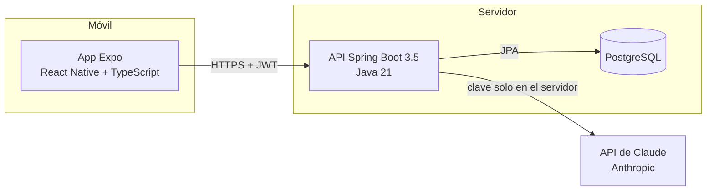
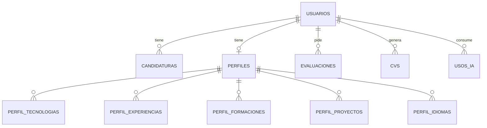
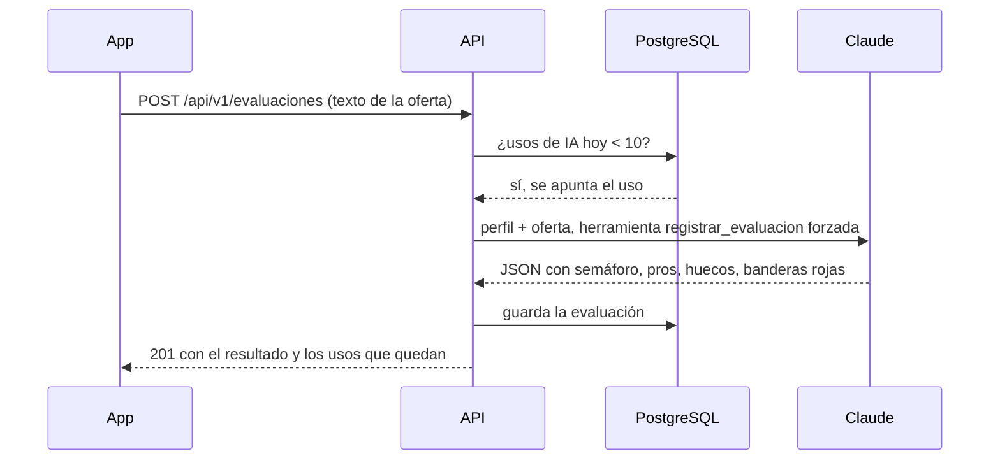

# arquitectura

Luz Verde tiene dos piezas: una API REST en Spring Boot con PostgreSQL y una app Android en React Native con Expo. La app no guarda datos propios salvo el token de sesión y la URL del servidor.

## backend

Paquetes de `es.albertocll.luzverde`:

| Paquete | Qué hace |
|---|---|
| `auth` | Registro, login, emisión de JWT y límite de intentos fallidos |
| `seguridad` | Validación del token en cada petición |
| `usuario` | Entidad y repositorio de usuarios |
| `candidatura` | CRUD de candidaturas, filtradas siempre por el usuario del token |
| `perfil` | Perfil profesional: stack con niveles, experiencia, formación, proyectos, idiomas |
| `ia` | Cliente de la API de Claude, límite diario de uso y utilidades para leer su salida |
| `evaluacion` | Evaluador de ofertas con semáforo |
| `cv` | Generador de CV en PDF y DOCX, carta y `GuardianVeracidad` |
| `error` | Traducción de excepciones a respuestas `ProblemDetail` en español |
| `config` | Seguridad, OpenAPI y reloj |

Cada controlador recibe el usuario del token con `@AuthenticationPrincipal` y los servicios buscan siempre por `id` y `usuarioId` a la vez. Si un recurso es de otro usuario, la API responde 404, igual que si no existiera.

## modelo de datos

Las listas del perfil son colecciones de elementos embebidos con columna de orden. El PDF y el DOCX de cada CV se guardan en la tabla `cvs` como `bytea`.

## flujo de una evaluación

El generador de CV sigue el mismo camino. Después pasa la salida del modelo por `GuardianVeracidad` antes de maquetar el PDF y el DOCX.

## app

| Carpeta | Contenido |
|---|---|
| `src/app/` | Pantallas de Expo Router. `(tabs)` agrupa las cuatro pestañas |
| `src/componentes/` | Componentes de interfaz reutilizables |
| `src/api.ts` | Cliente HTTP con el token y los mensajes de error en español |
| `src/auth.tsx` | Contexto de sesión guardado en `expo-secure-store` |
| `src/tema.ts` | Colores, espaciados y nombres de estados y semáforos |
| `tests/` | Tests con Jest y Testing Library |

### modo demo

`npm run web:demo` arranca la app en el navegador con `react-native-web`. La API real se sustituye por `src/demo/apiDemo.ts`, que trabaja en memoria con los datos de `src/demo/datos.ts`, y `src/almacen.ts` guarda la sesión en memoria porque SecureStore no existe en la web. Solo se activa con `EXPO_PUBLIC_DEMO=1` y no entra en la build normal.

## pruebas

| Dónde | Qué | Cómo |
|---|---|---|
| Backend | Integración de cada endpoint con MockMvc y H2 | `mvn verify` |
| Backend | API de Claude simulada con MockRestServiceServer y `@MockitoBean` | Sin gastar créditos |
| Backend | Seguridad: tokens manipulados, fuerza bruta, acceso a datos ajenos, cabeceras | `SeguridadTest` |
| Backend | Cobertura de líneas mínima del 70 % | JaCoCo en `verify` |
| App | Utilidades, cliente HTTP y componentes | `npm test` |
| CI | Todo lo anterior, búsqueda de secretos y CodeQL | GitHub Actions |
