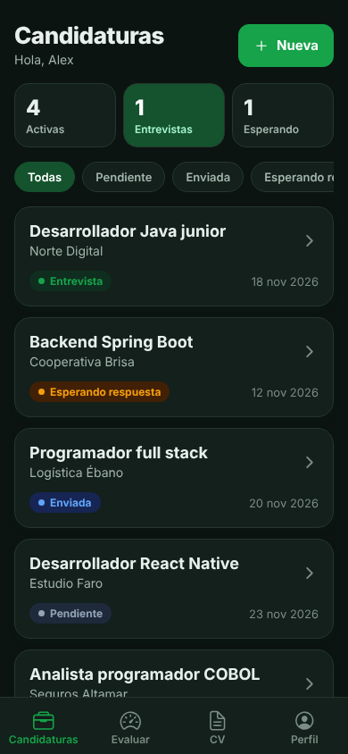

# interfaz y experiencia de uso

## principios

- Una acción principal por pantalla, en verde. Las secundarias van en blanco con borde.
- El semáforo es el elemento visual de la marca: aparece en el login, en cada evaluación y en el historial.
- Los colores de estado y de semáforo siempre van con texto. El color solo no basta para quien no distingue el rojo del verde.
- Los errores dicen qué hacer: "No se puede conectar con el servidor (URL). Revisa la URL en Perfil", y no "Error 0".
- Nada de pantallas vacías sin explicación. Cada lista vacía dice qué hacer para llenarla.

## pantallas

| Pantalla | Qué resuelve |
|---|---|
| Login | Entrar o crear cuenta en la misma pantalla. La URL del servidor queda plegada para no confundir |
| Candidaturas | Resumen de activas, entrevistas y esperando respuesta. Filtro por estado con chips. Tirar hacia abajo recarga |
| Candidatura | Alta y edición. Estado con chips de color. Botón para abrir la oferta y borrado con confirmación |
| Evaluar | Pegar oferta, ver semáforo, "Qué hacer ahora", lo que tienes a favor, lo que te falta y banderas rojas. Desde el resultado se guarda como candidatura o se genera el CV |
| CV | Generar CV para una oferta, descargar PDF o Word con el menú de compartir de Android, leer y compartir la carta y ver los huecos |
| Perfil | Barra de progreso con lo siguiente que conviene rellenar. Stack con niveles, experiencia, proyectos, formación, idiomas, servidor y cerrar sesión |

## onboarding

Hasta que el perfil está al 65 %, las pestañas Candidaturas y Evaluar muestran una tarjeta "Completa tu perfil" con el porcentaje y lo siguiente que falta. Al pulsarla se abre Perfil. Sin perfil, la evaluación es vaga y el CV sale casi vacío, porque no puede inventar nada.

## accesibilidad

- Botones, chips y tarjetas pulsables declaran su rol y su estado (`selected`, `disabled`, `busy`).
- Cada campo de texto usa su etiqueta como `accessibilityLabel` y el error o la ayuda como pista.
- Los avisos de error se anuncian con `accessibilityLiveRegion`.
- El semáforo se lee como "Semáforo verde", "Semáforo amarillo" o "Semáforo rojo".
- La barra de progreso del perfil expone su valor.
- Áreas táctiles de 40 px o más y texto base de 15 px.

## modo oscuro

La app sigue el tema del sistema al abrirse (`userInterfaceStyle: automatic`). `src/tema.ts` tiene dos paletas con los mismos nombres de color, y `tests/tema.test.ts` comprueba sus contrastes: texto principal AAA, texto secundario y verde de títulos AA. Si el usuario cambia el tema con la app abierta, se aplica la próxima vez que la abra, porque los estilos se crean al cargar cada pantalla.

## pendiente de revisar en un dispositivo

- Contraste de los textos tenues sobre fondo claro con una herramienta de contraste.
- Navegación completa con TalkBack.
- Pantallas pequeñas (360 px de ancho), sobre todo la fila de niveles del stack en Perfil.
- Modo oscuro en un Android real (probado solo en la web del modo demo).
